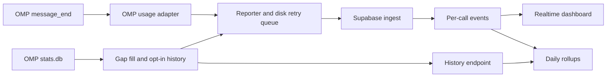

# Coding harness support review

Checked: 2026-10-24. Scope: repository review and integration research; no application implementation changes. Upstream `main`/`dev` links describe inspected source, not a tested minimum release.

**Backfill follow-up:** Current scope is Claude Code and Codex only. The [focused backfill analysis](claude-codex-backfill.md) supersedes the telemetry-first recommendation below when historical imports are required: prefer shared local parsing with explicit accounting-quality limits. Claude historical output completeness and legacy Codex reconstruction remain validation gates.

## Recommendation

Add Claude Code and Codex through a small standalone local collector receiving **completed-request OpenTelemetry log events**, with separate adapters normalizing them into tokenmunchers usage events. Keep OMP's native plugin. Add OpenCode through its native plugin interface rather than forcing every harness through the same collection mechanism.

Start with Claude Code, whose documented request event closely matches the existing contract, then Codex. Do not declare either supported until actual CLI sessions establish event identity, completeness, privacy, replay behavior, and token totals. A shared telemetry transport is useful; it does not eliminate harness-specific adapters.

Combined leaderboard totals can use the current backend contract. Per-harness breakdowns and accurate unknown/estimated-cost presentation require coordinated backend/dashboard changes; they are not prerequisites for demonstrating token collection, but must be settled before advertising those capabilities.

## Repository architecture

Current integration: **Oh My Pi (OMP)** only, packaged as `omp-tokenmunchers`.

- [`plugin/index.ts`](../plugin/index.ts) owns OMP lifecycle hooks and `/munch` commands.
- [`plugin/src/adapter.ts`](../plugin/src/adapter.ts), lines 10–24 and 112–146, defines the usage contract and OMP message conversion. This is the existing normalization seam.
- [`plugin/src/transport.ts`](../plugin/src/transport.ts) handles bearer authentication, HTTP delivery, batching, and disk retries. It is a reuse candidate, but currently internal to the OMP package.
- [`plugin/src/syncer.ts`](../plugin/src/syncer.ts), [`sync.ts`](../plugin/src/sync.ts), and [`stats.ts`](../plugin/src/stats.ts) depend on OMP's `omp stats` command/database. They are not a generic multi-harness history module.
- [`supabase/functions/ingest/index.ts`](../supabase/functions/ingest/index.ts) accepts normalized metadata, not arbitrary telemetry. Database jobs create daily totals; the dashboard combines live events, rollups, and imported history.

## Review findings and integration constraints

These are existing constraints and conditional integration risks, not claims that current OMP sessions are colliding.

### 1. Token categories must be disjoint

[`20261004220000_init.sql`](../supabase/migrations/20261004220000_init.sql), lines 50–55, generates total tokens by adding input, output, cache-read, and cache-write counts. Sending inclusive input plus its cached subset overcounts usage.

Claude Code documents exclusive input counts. Codex distinguishes inclusive input from cached input; for the ordinary OpenAI cache-read case, normalize `input_tokens = input_token_count - cached_token_count`, and place the cached count in `cache_read_tokens`. Do not add reasoning tokens again when included in output. Codex also exposes cache-write counts: validate their relationship to input for supported providers before generalizing this formula to nonzero cache-write cases. Sources: [Claude request event](https://code.claude.com/docs/en/monitoring-usage#api-request-event), [Codex token accounting](https://github.com/openai/codex/blob/main/codex-rs/tui/src/token_usage.rs), [Codex telemetry implementation](https://github.com/openai/codex/blob/main/codex-rs/otel/src/events/session_telemetry.rs).

### 2. History replacement is device-scoped, not harness-scoped

[`20261005120000_history_and_retention.sql`](../supabase/migrations/20261005120000_history_and_retention.sql), lines 278–295, deletes all history for `(user_id, device_id)` on reset. Two collectors sharing a device ID could erase each other's imported history. Give each source its own persisted import/device identity and cursor state, or explicitly migrate replacement semantics.

Do not reuse OMP's legacy account-wide history cutoff as a new source's activation time. Validate live/import overlap separately for every adapter.

### 3. Event and presence identities need source isolation

OMP event IDs hash `sessionKey|timestamp|provider|model` in [`adapter.ts`](../plugin/src/adapter.ts), lines 79–86. The database uses a global event primary key; presence uses `(user_id, session_id)` in [`init.sql`](../supabase/migrations/20261004220000_init.sql), lines 42–45 and 80–88.

Namespace new collectors' event identity inputs and session IDs by harness. Event IDs must remain UUIDs, not literal prefixed strings; session IDs must remain within 128 characters. Preserve OMP's existing event IDs to avoid re-keying already reported calls. A turn ID alone is insufficient when one turn makes multiple model calls.

### 4. Unknown cost currently looks like zero

[`adapter.ts`](../plugin/src/adapter.ts), lines 138–140, maps missing/invalid cost to zero. The backend requires numeric cost and stores it non-null. This cannot distinguish unavailable pricing from genuinely zero cost. OMP's [existing documentation](../plugin/README.md) also distinguishes subscription live usage from estimated history pricing.

For broader support, define cost as source-reported/estimated rather than billed spend, and represent unavailable cost explicitly if displayed. Claude's event documents `cost_usd` as an estimate; do not infer invoice amounts or subscription billing mode from a zero value. [Source](https://code.claude.com/docs/en/monitoring-usage#api-request-event).

### 5. A harness field requires a full contract change

[`ingest/index.ts`](../supabase/functions/ingest/index.ts), lines 38–58 and 74–77, rejects unknown event fields. Raw events, daily totals, history, and presence currently have no harness dimension.

- **Aggregate-only:** unchanged payload, source-isolated identities/state, combined totals.
- **Attributed:** migrate validation, raw/history/daily storage and keys, rollup functions/views, dashboard types/queries, and onboarding together. Adding a column only to raw events loses attribution after retention/rollup.

## Codex and Claude Code collection options

| Harness | Preferred live signal | Mapping and identity constraints | History/recovery |
| --- | --- | --- | --- |
| Claude Code | Documented `claude_code.api_request` OTel log event | Input/output/cache-read/cache-creation, estimated cost, timestamp and session attributes. Prefer server `request_id`; it is conditional. `client_request_id` is also conditional. Prove a durable fallback when both are absent. | Local transcripts are an opt-in candidate; Anthropic explicitly calls their format internal and changeable. |
| Codex CLI | Documented `codex.sse_event`, filtered to `event.kind=response.completed` | Source emits `input_token_count`, `output_token_count`, `cached_token_count`, `cache_write_token_count`, and reasoning counts. Prove per-response identity and event coverage across supported transports/providers; do not use a cumulative usage snapshot as a new call. | Rollout JSONL is a candidate for version-aware recovery/backfill. Do not assume the internal SQLite metadata database is a complete usage ledger. |

Primary sources: [Claude monitoring](https://code.claude.com/docs/en/monitoring-usage), [Claude event correlation](https://code.claude.com/docs/en/monitoring-usage#event-correlation-attributes), [Claude transcript storage](https://code.claude.com/docs/en/sessions#where-transcripts-are-stored), [Codex telemetry configuration](https://learn.chatgpt.com/docs/config-file/config-advanced#observability-and-telemetry), [Codex event implementation](https://github.com/openai/codex/blob/main/codex-rs/otel/src/events/session_telemetry.rs), [Codex rollout recorder](https://github.com/openai/codex/blob/main/codex-rs/rollout/src/recorder.rs).

Important distinctions:

- **OTel events are not OTel aggregate metrics.** Token/cost counters do not automatically provide one deduplicable record per model call. Consume one chosen completed-usage signal, not logs plus metrics plus spans for the same call.
- **Hooks are not a usage feed.** Documented lifecycle hook inputs are not equivalent to OMP's completed-message usage callback. A hook/transcript integration still needs a version-aware parser. See [Claude hooks](https://code.claude.com/docs/en/hooks) and [Codex hooks](https://learn.chatgpt.com/docs/hooks).
- **A wrapper/SDK is narrower than passive CLI support.** Usage from processes launched by an integration does not establish coverage of users' existing interactive sessions.
- Telemetry is opt-in and configuration may be constrained by managed settings. Claude supports OTLP HTTP JSON/protobuf and gRPC; Codex documents user-level `[otel]` export configuration. Verify chosen protocols against pinned releases rather than assuming identical environment-variable behavior. [Claude configuration](https://code.claude.com/docs/en/monitoring-usage#configuration-details), [Codex configuration](https://learn.chatgpt.com/docs/config-file/config-advanced).

## Other harnesses worth considering

Priority below reflects integration fit, not measured popularity or market share.

| Candidate | Supported integration surface | Recommendation |
| --- | --- | --- |
| OpenCode | Native JS/TS plugins and message events | Best next native-plugin candidate. Verify completion/update cadence and stable message IDs; do not count every message update as a call. Prefer the plugin over internal database coupling. [Official plugins](https://opencode.ai/docs/plugins/), [upstream interface](https://github.com/anomalyco/opencode/tree/dev/packages/plugin). |
| Gemini CLI | Built-in OTel logs, metrics, and traces | Good reuse candidate for the collector transport. Verify cached-input and thoughts/output relationships plus replay identity. **Prompt logging defaults to enabled in the inspected telemetry guide**; disable it explicitly. [Official telemetry guide](https://github.com/google-gemini/gemini-cli/blob/main/docs/cli/telemetry.md). |
| GitHub Copilot CLI | First-party OTel instrumentation | Worth a subsequent adapter. Validate the actual request-level token schema and identity; do not conflate the standalone CLI with the legacy `gh copilot` extension. [GitHub observability docs](https://docs.github.com/en/copilot/concepts/enterprise/opentelemetry), [CLI reference](https://docs.github.com/en/copilot/reference/copilot-cli-reference/cli-command-reference#opentelemetry-monitoring). |
| Cursor | Enterprise, server-side OTel export | Defer for this friend-group product unless there is an Enterprise user. Requires publicly reachable HTTPS OTLP/protobuf, not a loopback-only collector. Logs are at-least-once; billing correction events also need handling beyond today's insert-on-conflict model. [Official export contract](https://cursor.com/docs/enterprise/opentelemetry-export.md). |

## Recommended implementation sequence

1. **Define adapter invariants:** disjoint token counts; stable source-scoped event/session IDs; isolated history state; cost availability; pause and opt-in history semantics. Choose aggregate-only versus attributed reporting explicitly. Preserve existing OMP identities.
2. **Implement a small local completed-event collector:** loopback-only, configurable endpoint; harness-specific adapters; strict metadata projection before disk/network delivery. Reuse or extract the proven transport only where both integrations actually need it; do not generalize OMP's stats reader or `Syncer`.
3. **Validate Claude Code, then Codex:** make real model calls with cache usage and subagents, perform a multi-call tool turn, resume a session, retry delivery, restart the collector, and replay events. Reconcile totals against each harness. Pin supported versions and state configuration requirements. Codex's per-response identity and transport coverage remain release gates, not solved facts.
4. **Add OpenCode, then consider Gemini/Copilot:** reuse normalization/delivery where appropriate, not one universal event parser. Add source-specific offline imports only after overlap/dedup semantics are established.
5. **Update product surfaces at release:** root/package READMEs, Supabase contract docs if changed, and OMP-only setup instructions in [`SettingsClient.tsx`](../dashboard/app/settings/SettingsClient.tsx).

Privacy is part of the interface: accept recognized completed-usage records only, build fresh allowlisted events, and never persist/forward raw telemetry or arbitrary resource attributes. Codex telemetry can include tool output snippets even with prompt logging disabled. Bind locally; do not silently replace an organization's existing collector configuration. Existing promises that paused calls are never imported later must also hold for new collectors. Sources: [Codex emitted events](https://learn.chatgpt.com/docs/config-file/config-advanced#observability-and-telemetry), [Claude telemetry privacy](https://code.claude.com/docs/en/monitoring-usage), [current privacy contract](../README.md#privacy).

## Verification actually performed

- Ran `npm test` in `plugin/` on Node v26.8.1: **28 passed, 1 failed** out of 29 tests.
- Failure: [`plugin/test/plugin.test.ts`](../plugin/test/plugin.test.ts), line 186, reads `last.events.length`. Its fixture at line 27 is dated October 4; at review time it was about 19.83 days old. [`transport.ts`](../plugin/src/transport.ts), lines 17 and 225, discards queued events older than 6.5 days, so no retry batch is sent and the final recorded request is a heartbeat. This explains the observed clock-dependent test failure; it is not evidence of a production retry failure. A future fix should inject a consistent clock/current fixture while retaining meaningful retention coverage.
- Separate throwaway runtime smoke imported the actual `toUsageEvent` and `Reporter` and used a real localhost HTTP server. Two HTTP 503 deliveries produced two queued events; switching to HTTP 200 and calling `flush(true)` delivered both and emptied the queue. Checked distinct event IDs, bearer-header formatting, and absence of injected secret assistant content from outgoing payloads. Temporary state was removed.
- No Codex/Claude/Gemini/Copilot/Cursor integration was implemented or exercised. No deployed backend, database, OMP UI, or dashboard was exercised. New-harness feasibility is source-backed research, not end-to-end runtime proof.
